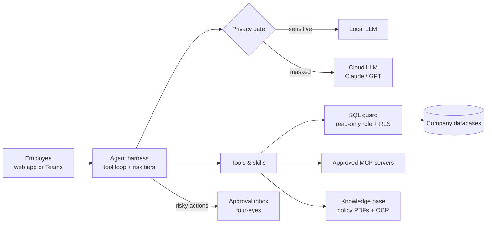

# Delegate — an AI co-worker for every employee

> Any employee types what they need in a chat. Agents do the work through the company's own databases, tools and MCP servers — and stop for a human approval before anything risky.

**Role:** solo builder (product, architecture, backend, UI) · **Period:** Oct 2026 – present · **Status:** core in production since October 2026; organisational context in development · *"Delegate" is a working name*

---

## 1. The problem
Banks and large contact centres want staff to use AI, but they cannot hand a general chatbot their customer database. The questions are always the same: which data can the model see, who approves an action, which model is allowed for which data, and who is accountable when an agent gets it wrong. Off-the-shelf assistants answer none of these for an on-prem, regulated environment.

Delegate grew out of [VoiceOS](../voiceos/): once the voice agent could look up data and act safely, the same engine could serve every employee, not just callers.

## 2. What I built

**Agent harness** — my own thin tool-calling loop instead of a framework, so every step can be logged, limited and replayed.
- **Risk tiers R0–R4** for every tool: R0 read-only runs freely; higher tiers need approval; R4 is human-only.
- **Four-eyes approval inbox** — an agent's risky action waits for a second person.
- **Safe database access** — SQL is checked by a guard, runs under a read-only database role with row-level security, and goes through a semantic layer that names business concepts.
- **Skills, automations and an agent factory** — teams package repeatable work as skills, schedule routines, and create their own agents from a template.

**Workspace for staff**
- Chat-first app shell with workspaces, projects, groups and sharing
- Knowledge assistant that answers from internal policy PDFs with citations, including scanned documents (OCR), also available as a Microsoft Teams bot
- Document output: Word, PowerPoint and Excel
- Web search through a self-hosted search engine, morning briefs, notifications, memory
- **"My connections"** — staff connect their own MCP servers by URL or OAuth; a manager and then an admin approve each one before an agent can use it

**Organisational context (in development)** — a company charter, goals that cascade down to teams, and document governance, so agents work from the organisation's priorities rather than a blank prompt.

### Architecture

## 3. Hard problems I solved

**Customer data must never reach the model.** When an agent queries a database, the rows stay out of the prompt. The model receives a handle (`res_1`, `res_2`) and metadata — column names, row count — and the app swaps the real values back in on screen. Personal data is pseudonymised inside the SQL itself, so even an aggregate the model does see carries no names.

**Two kinds of LLM, two kinds of trust.** A control model chosen by the company (local where required) oversees the work; each employee can bring their own key for the working model. Secret or personal data goes only to the local model; everything else is masked before it reaches a cloud model. Every new tool and every new database column must be classified for sensitivity before it ships.

**An agent that can act needs a brake, not just a prompt.** Prompt instructions are not a control. Every tool has a risk tier enforced in code, and anything above read-only lands in an approval inbox with the exact action and its inputs, so a person approves what will actually run.

**Data residency is a design input.** In New Zealand and Mongolia alike, the only way to guarantee data stays in the country is to run the model locally. So every model in Delegate can be swapped for a local one, and the platform installs on-prem as well as running as a service.

## 4. Results
- Agent harness, skills, app shell and knowledge assistant in production between October and November 2026; the four-eyes approval inbox is built and being switched on
- One codebase serving both a hosted service and an on-prem bank installation
- Voice agent, meeting-minutes agent and knowledge assistant all run as modules of the same platform

## 5. Stack
Python · FastAPI · PostgreSQL (row-level security, read-only roles) · pgvector · MCP (client, OAuth) · Claude · GPT · local LLMs · OCR · Microsoft Teams · SearXNG · vanilla JS single-page app

---
*Source code is private. Live walkthrough available on request.* · Licence: CC BY-NC-ND 4.0
