# VoiceOS — Mongolian AI Voice Agent & CX Platform

> A customer calls a normal phone number. An AI operator answers in Mongolian, understands the request, looks up the customer's data, and resolves it — or hands over to a human. Supervisors watch it live in a console.

**Role:** solo builder (product, architecture, backend, console UI, ML fine-tuning) · **Period:** Jul 2026 – present · **Status:** live in production on a real phone number; bank on-prem edition in testing

---

## 1. The problem
Mongolian SMEs and banks cannot afford 24/7 phone coverage, and no vendor offers a Mongolian-language voice agent. Off-the-shelf voice AI (Vapi, Retell, ElevenLabs) has no Mongolian STT/TTS and sends audio abroad — which banking regulation does not allow.

## 2. What I built

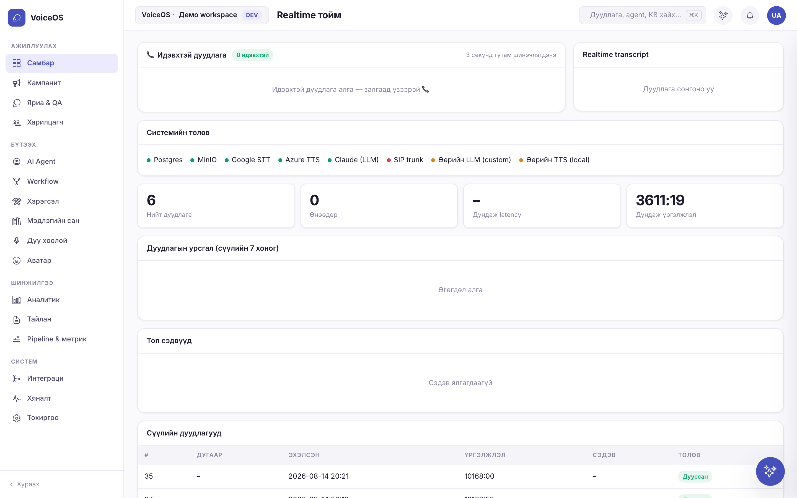

**Telephony chain** — PSTN number → carrier SIP trunk → **Asterisk** → **LiveKit SIP** → Python agent worker (streaming STT → LLM → TTS) with live function calls into the business database.

**Two conversation modes** — a cascade (speech to text → workflow engine + LLM → text to speech) for scripted flows such as loan-repayment calls, and a single speech-to-speech model for open information questions, with a tool that transfers the caller to a human.

**Callers who don't speak Mongolian** — a language-ID model labels each caller's language and keeps it for the whole call, so one English word doesn't flip the conversation. English, Russian and Kazakh speakers go to the right queue, and the bot tells them before it transfers, not after.

**Bank contact-centre integration** — for the on-prem edition the bot plugs into the bank's existing contact-centre platform (Ameyo): it takes calls as a SIP peer, hands over to the right queue of human agents, and releases the line cleanly on every exit path.

**Admin console (14 screens, FastAPI + single-page app)**
- Live-call dashboard and call history with full transcripts and audio
- Conversation review with per-turn latency and cost
- Drag-and-drop **workflow canvas** with draft / publish safety
- **Meeting minutes agent** — recordings to official minutes and per-person action emails ([case study](../meeting-minutes/))
- Hierarchical **RAG knowledge base** (Postgres + pgvector), 590+ documents in production
- Integrations hub: SIP, channels (phone, Messenger, WhatsApp, SMS, web chat), API keys, iPaaS recipes, retention & compliance
- Outbound dialler for reminders, confirmations and loan-repayment campaigns
- Multi-tenant (row-level security), RBAC, MFA / LDAP, CSP and audit log — hardened to bank security requirements

**Mongolian speech models** — speech recognition and synthesis are pluggable per organisation. The hosted edition can use a commercial streaming recogniser; the bank edition runs my fine-tuned **Nemotron** recogniser and **Magpie TTS** on the bank's own CPU servers. The main voice is a **VoxCPM2** model fine-tuned on Mongolian. Full write-up: [Mongolian Speech Models](../speech-models/).

**Avatar (experimental)** — MuseTalk lip-sync avatar streamed through LiveKit: ~300 ms per frame, 22 fps on a single RTX 4090.

### Architecture
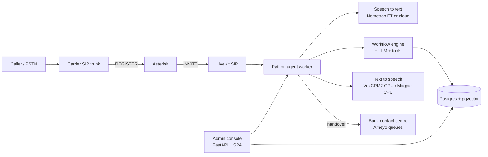

## 3. Hard problems I solved

**Calls never arrived.** The carrier trunk is registration-based (it expects a device to SIP REGISTER) while LiveKit SIP only accepts INVITEs. The two never met, so calls failed silently. Putting Asterisk in the middle as the registering endpoint fixed it; I also had to separate RTP port ranges and remove a PJSIP / chan_sip conflict.

**Background voices answered the bot.** A family member talking near the phone would trigger the agent. Solved with streaming diarization that locks onto the caller. Measured on live calls: every piece of background speech rejected, every caller question passed through, median added lag 430 ms.

**Carrier audio that sounded fine but was silent.** One operator's mobile-originated calls arrived with no audio. The cause was a codec and media-timeout mismatch in the distribution's SIP stack, not the application. Now every trunk the console generates is pinned to a single codec and an explicit media timeout.

**Every tenant brings their own phone number.** This is a platform, not one company's deployment, so telephony configuration cannot live in environment files. Organisations connect their own carrier numbers through the console, choose which number each agent uses for inbound and outbound, and the SIP configuration is generated from the database and reloaded — no container restart, no engineer involved.

**Latency is a budget, not a number.** In September the first response took about 7.5 seconds; it is now 2–3 seconds. Measuring each stage showed where the time went: 1.3 s deciding the caller had finished, 1.2 s in an intent classifier, and 1.4 s waiting for a whole synthesised audio file before playing any of it. Streaming speech out as soon as the first sentence is ready, plus a faster speech engine, removed most of it.

**A bank server with no internet and no Docker.** The bank's test server runs RHEL 8 with Podman, and every public registry and GPU cloud is blocked. Releases ship as one bundle — container images, code and SHA-256 checksums — installed by a single script, with a code-only mode that updates the application without touching infrastructure images.

**Compression broke the recogniser.** To run speech recognition on CPU, I built the open-source NeMo-Speech.cpp runtime for the bank's servers. The 8-bit quantised model started repeating words in its output; the 16-bit model did not, so the bank runs 16-bit. A smaller model is only a win if its transcripts are still checked.

**A partial deploy took production down** once. Config loader, tenancy and the main service now ship together, gated by lint and security checks.

## 4. Results
- End-to-end Mongolian voice conversation over a real phone number, in production
- First response in 2–3 seconds, down from about 7.5
- Bank on-prem edition with its own speech models on CPU and contact-centre integration, in testing
- Console covering the full operator and supervisor workflow, 16 screens
- Multi-tenant: organisations self-serve their own numbers, channels, knowledge bases and AI models
- Own speech models replacing paid APIs — see the [speech models case study](../speech-models/)
- Meeting-minutes agent built on the same platform — see [Meeting Minutes](../meeting-minutes/)
- 3,179 automated tests, lint and security scan gating every deploy
- Business plan and unit economics written for the Mongolian SME market

## 5. Screenshots
| | |
|---|---|
| 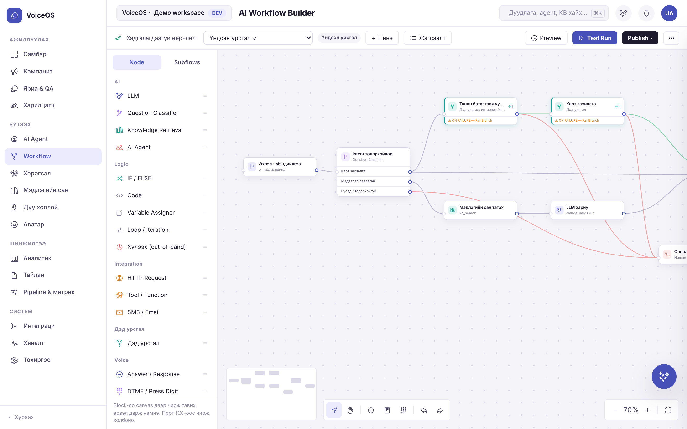 | 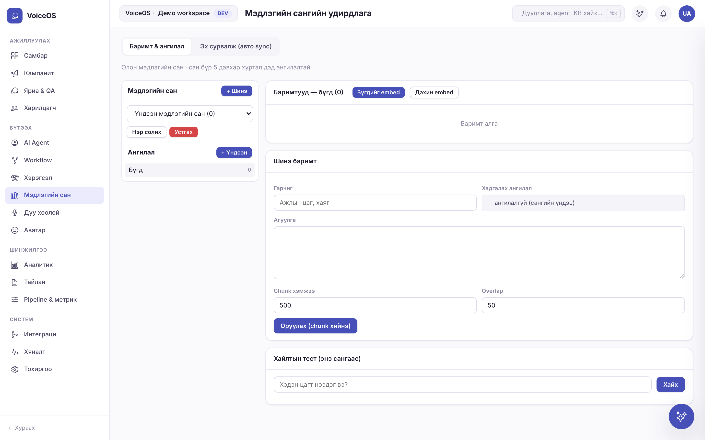 |
| 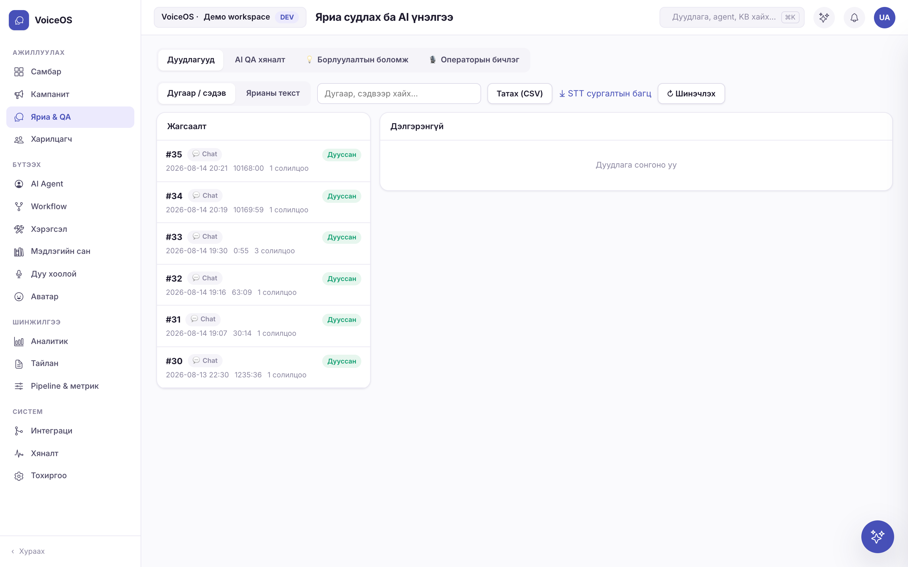 | 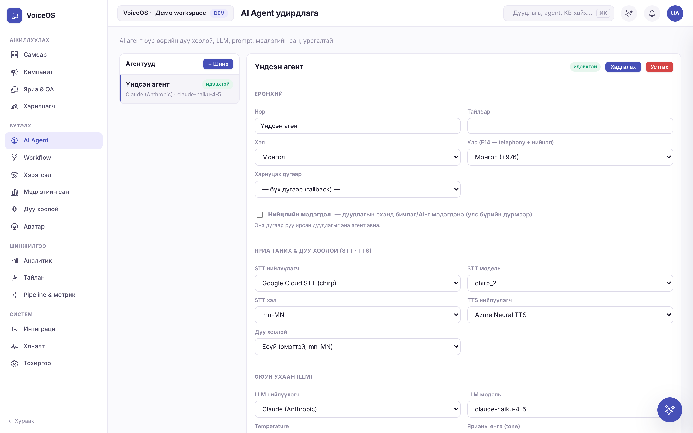 |
| 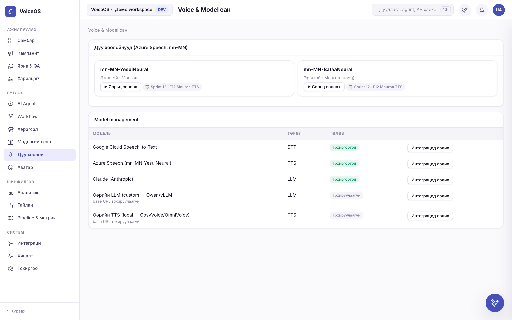 | 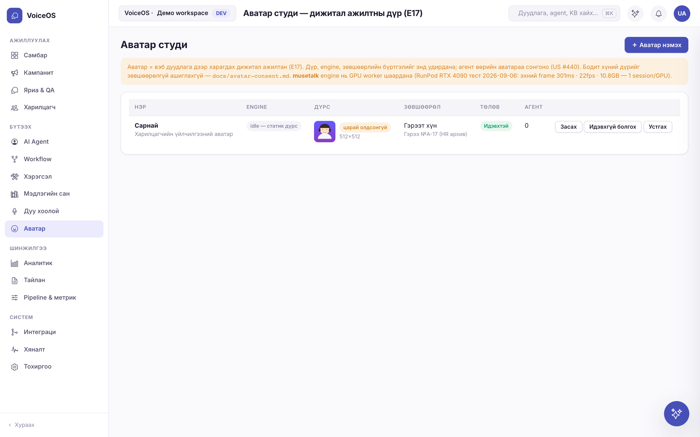 |
| 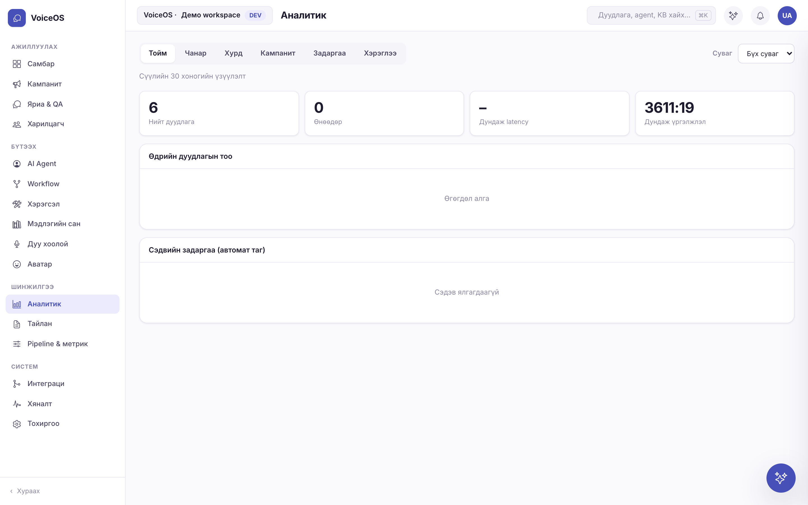 | 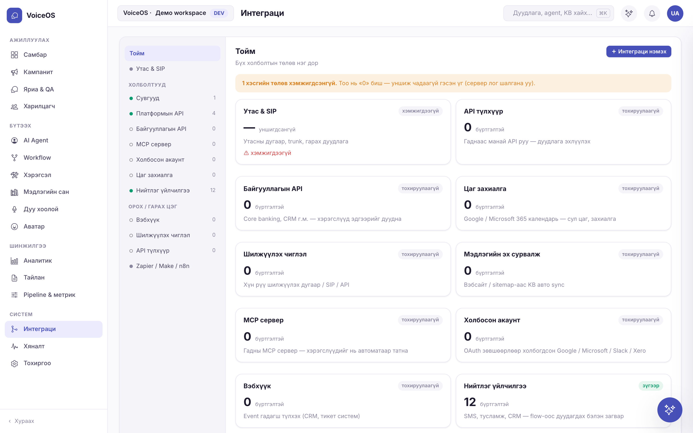 |
| 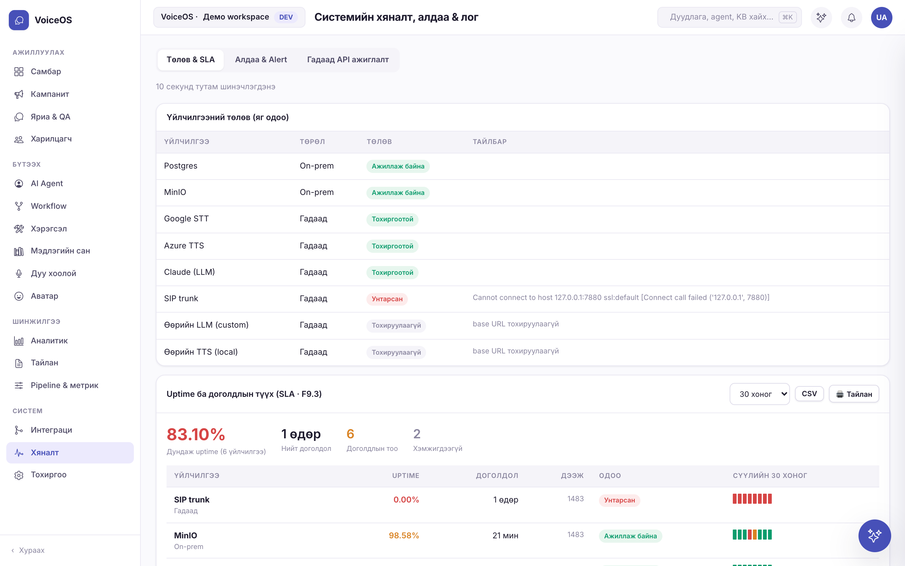 | 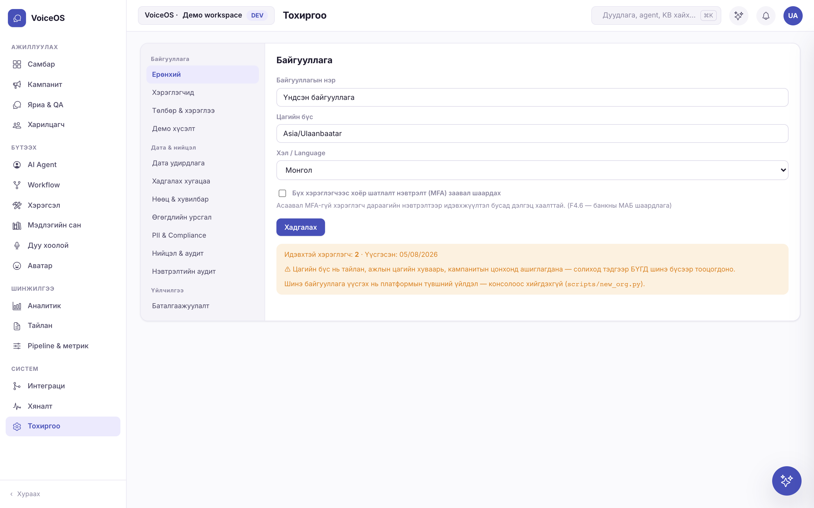 |

## 6. Stack
Asterisk · LiveKit (SIP + agents) · Python · FastAPI · PostgreSQL + pgvector · Redis · MinIO · Docker / Podman · RunPod GPUs · NVIDIA NeMo (Nemotron ASR, Magpie TTS) · NeMo-Speech.cpp · VoxCPM2 · Whisper · MuseTalk · Claude / GPT / open-weight LLMs · Azure DevOps boards

---
*Source code is private. Live walkthrough available on request.* · Licence: CC BY-NC-ND 4.0
